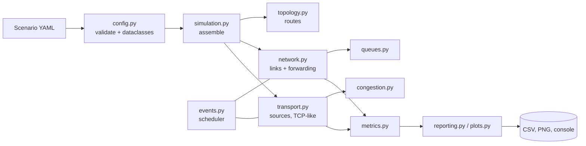
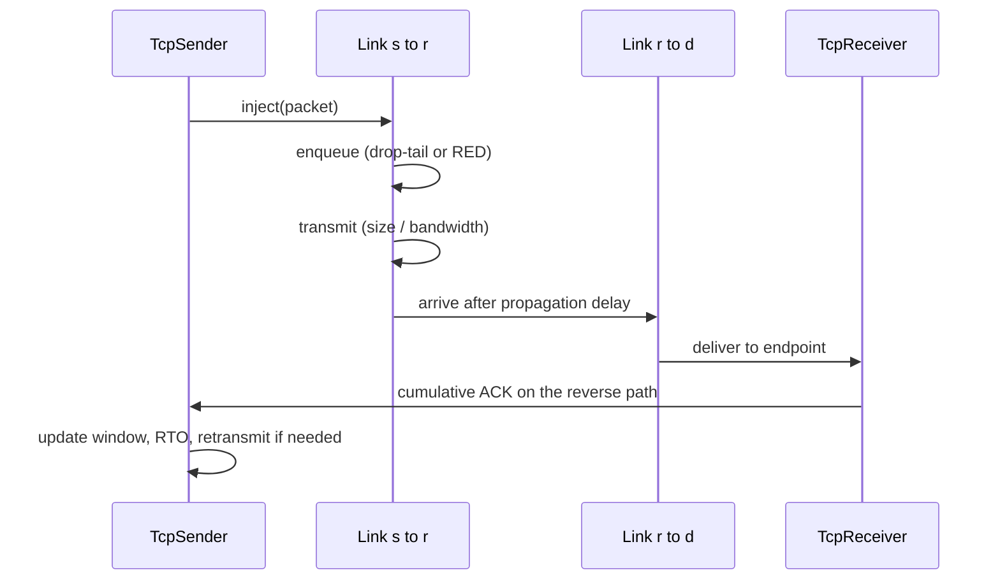

# Architecture

Packetscape is a single-process, single-threaded discrete-event simulation. Everything that happens is an event on one clock; nothing runs concurrently, which is what makes runs deterministic.

## Component view

Dependencies point downwards: `config` knows nothing about the simulation, `queues` and `congestion` know nothing about the scheduler, and `metrics` is a passive sink.

## Packet life cycle

A packet carries its full path and the index of the node that holds it. `Network.forward` either hands it to the next link or, at the last node, to the endpoint registered for `(flow_id, is_ack)`.

## Link model

Each direction of a physical link is a separate `Link` with its own queue:

1. `send()` offers the packet to the queue. A rejected packet is recorded as a queue drop.
2. If the transmitter is idle it dequeues the head packet and schedules the end of serialization after `size_bytes * 8 / bandwidth`.
3. When serialization ends, the next packet starts transmitting immediately and the finished packet is scheduled to arrive after the propagation delay.
4. On arrival the link may drop the packet with the configured random loss probability; otherwise the network forwards it.

## Transport model

`TcpSender` keeps `snd_una` (lowest unacknowledged sequence), `next_seq`, a duplicate-ACK counter, a `recover` marker and a retransmission timer.

- **New ACK:** advance `snd_una`, take an RTT sample (skipped for retransmitted packets), tell the controller, re-arm or cancel the timer, send more data while `inflight < floor(cwnd)`.
- **Duplicate ACK:** after three, and only once per recovery window, notify the controller and retransmit `snd_una`.
- **Timeout:** notify the controller, double the RTO (capped), retransmit `snd_una`.

`CongestionControl` implementations are small state machines with `on_ack`, `on_fast_retransmit` and `on_timeout`, so adding an algorithm does not touch the sender.

## Randomness

Every stochastic component (each queue, each link, each Poisson source) draws from its own `random.Random` stream derived from `(seed, component name)`. See [ADR 0002](adr/0002-seeded-per-component-randomness.md).

## Extension points

| To add | Implement | Register in |
|---|---|---|
| A queue discipline | `QueueDiscipline` in `queues.py` | `make_queue` in `simulation.py`, `QUEUE_TYPES` in `config.py` |
| A congestion controller | `CongestionControl` in `congestion.py` | `make_congestion_control`, `CC_NAMES` in `config.py` |
| A traffic source | A class with `start()` that schedules injections | `Simulation._build_flows` |
| A metric | A method on `MetricsCollector` plus a field on `FlowSummary` | `reporting.py` |

## Testing approach

- Unit tests for each module with hand-computed expectations (for example, serialization plus propagation time on a link).
- Behavioural tests for algorithms (window growth, reduction, queue thresholds) using fixed-value random streams.
- Scenario tests: a finite transfer over a clean link delivers every packet, a lossy link still delivers every packet eventually, identical seeds give identical results, and every example file builds.
